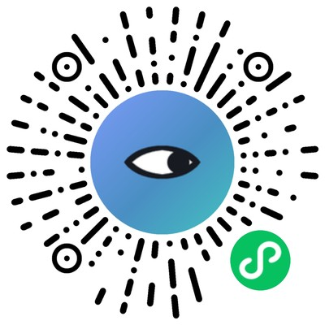

# 钓鱼指南 · 微信小程序

> 钓鱼指南 · 从入门到上鱼

 

<p align="center">
  微信扫一扫即可打开 · AppID <code>wx8c1919d5d5760dde</code>
</p>

一个给钓鱼人用的随身工具：按实时天气算「适钓指数」，配 33 种淡水 / 海水鱼图鉴、6 类钓法教学、饵料配方与路亚假饵速查，还能记渔获、管装备、收藏钓点。

数据全部存在本机，不注册、不上传；想换机不丢数据可以开云同步。

---

## 一、功能一览

### 1. 出钓指数（首页）

核心功能。给一组天气参数，算一个 0–100 的分数，告诉你今天该不该去、去了怎么钓。

- **自动获取**：授权定位后自动拉实时天气（气温、气压、风速风向、天气现象），自动填表
  - **数据源**：实况走**腾讯位置服务**（国内节点约 0.3s），逐小时预报走 **Open-Meteo**（境外约 1.4s，云函数内按 1km 网格 + 30 分钟缓存）
  - 腾讯字段在云函数里映射成 Open-Meteo 的 `current` 结构，前端与 `score.js` 零改动；腾讯不可用时自动整体退回 Open-Meteo
- **手动微调**：气温、气压可用滑块手动改，用于对比"如果……会怎样"
- **结果包含**：
  - 总评分 + 等级（极佳 / 良好 / 一般 / 较差 / 很差）
  - 七项因素得分条：气压、气温、天气、风力、季节、时段、风向
  - **今日时机**：日出日落、黄金窗口（晨昏）、月相
  - **逐时适钓**：未来 24 小时柱状图，点某小时看该时段的方案
  - **气压曲线**：近 24 小时气压走势（画在 canvas 上）
  - **出钓方案**：钓层与钓位、饵料方向、时段策略、气压解读、风力应对、建议目标鱼

### 2. 鱼种图鉴

33 种常见鱼，每种一张写实配图。

- **解锁系统**：在渔获日志里钓到过就解锁，未解锁的图置灰显示，列表按"已解锁优先"排序
- 顶部有解锁进度条（`X/33`），滚动时和搜索框一起吸顶
- **搜索**：支持鱼名、别名（如"草鱼 / 鲫 / 翘嘴"）；名称搜不到时降级按水层、栖息地找，并给出提示
- 详情页含：别名、水层、栖息地、体型、习性、钓法、饵料、注意事项

### 3. 钓法教学

- **6 类钓法**：台钓、传统钓、路亚、海钓、筏钓、冰钓（折叠展开，默认全收起）
- **30 条教学视频清单**，分 9 类：台钓线组 / 路亚线组 / 调漂找底 / 抛竿手法 / 看漂读口 / 开饵打窝 / 选位看水 / 路亚操控 / 新手入门
- 「放链接」形式：小程序不内嵌播放（个人主体不支持视频类目、易审核不通过），每条附**外部视频链接（B站对应关键词播放量最高的具体视频）**，点击复制后去微信 / 浏览器打开原平台观看

### 4. 饵料配方

- **季节配方**：按当前月份自动选中当季配方（春 / 夏 / 秋 / 冬 / 通用），每条含配比比例条、开饵用法
- **路亚假饵速查**（v1.1.1 新增）：13 种假饵，每种含类型、水层、对象鱼、操控手法、使用场景，卡片右上角配图

### 5. 我的

- 出钓次数 / 累计渔获 / 最大单尾 / 累计时长 四项统计
- 入口：渔获日志、钓点地图、附近水域、装备清单、数据统计、云同步、安全与法规
- 外观切换（深色 / 白天）
- 清空本机数据

### 6. 其他页面

| 页面 | 说明 |
|---|---|
| 渔获日志 | 记录每次出钓的时间、钓点、鱼种、数量、最大单尾、照片；带出钓计时器；可调用 AI 拍照识鱼 |
| 装备清单 | 分类装备清单，勾选择记录已备齐项 |
| 钓点地图 | 地图查看收藏钓点，支持选点新增 |
| 附近水域 | 按半径搜索附近的河流、水库、湖泊 |
| 钓点详情 | 单个钓点的详细信息与标签 |
| 战绩卡片 | 生成战绩卡片图（右下角带小程序码） |
| 钓点海报 | 生成带小程序码的钓点海报 |
| 分享给钓友 | 「我的」页展示小程序码，长按可存相册发群/朋友圈 |
| 数据统计 | 月度走势、鱼种构成、单尾纪录排行 |
| 云同步 | 日志与钓点的云端备份与恢复 |
| 安全与法规 | 高压线、禁渔期、涉水安全等须知 |
| 绑线组教学 | 视频清单（放链接，不内嵌播放） |

---

## 二、出钓指数算法

真相源在 `utils/score.js`，与 Web 版同一套口径。

**加权评分模型**：每个因素先转成 0–1 的适宜度，再按权重加权平均，最后 ×100。

| 因素 | 权重 |
|---|---|
| 气压 | 0.22 |
| 气温 | 0.18 |
| 天气 | 0.16 |
| 风力 | 0.14 |
| 季节 | 0.12 |
| 时段 | 0.10 |
| 风向 | 0.08 |

**典型评分表**：

- 天气：小雨/阵雨 0.92 > 多云 0.82 > 阴 0.70 > 晴 0.62 > 中雨 0.60 > 雾 0.45 > 雪 0.35 > 大雨 0.18 > 雷雨 0
- 风力：2 级最优 0.95，3 级 0.88，0 级 0.55，4 级 0.45，5 级 0.28，6 级 0.08
- 时段：清晨/傍晚 0.95，上午 0.72，夜间 0.68，下午 0.62，正午 0.22
- 风向：东北 0.82、东 0.80、北 0.72、静风 0.62、东南/南 0.55、西 0.45、西北 0.42、西南 0.28

**硬止损**：雷雨、6 级及以上大风属于安全问题，分数直接封顶 22 分并给出避险提示。

**日出日落**：NOAA 算法，`utils/sun.js`；月相在 `utils/moon.js`。

---

## 三、目录结构

```
fishing-guide-miniprogram/
├─ app.js / app.json / app.wxss    # 全局入口、页面注册、公共样式（含主题变量）
├─ pages/                          # 16 个页面
│  ├─ index/       出钓指数（核心）
│  ├─ fish/        图鉴列表 + 详情
│  ├─ method/      钓法教学（含 30 条视频清单·放链接）
│  ├─ bait/        饵料配方 + 路亚假饵速查
│  ├─ log/         渔获日志（含计时器、AI 识鱼）
│  ├─ gear/        装备清单
│  ├─ map/         钓点地图
│  ├─ nearby/      附近水域
│  ├─ spot/        钓点详情
│  ├─ card/        战绩卡片
│  ├─ poster/      钓点海报
│  ├─ stats/       数据统计
│  ├─ sync/        云同步
│  ├─ rules/       安全与法规
│  └─ mine/        我的
├─ data/
│  └─ fishing-data.js    # 唯一数据源：FISH / BAITS / LURES / METHODS / GEAR 等
├─ utils/
│  ├─ score.js      # 出钓指数算法（权重/评分表/硬止损）
│  ├─ weather.js    # 实时天气（走云函数代理）
│  ├─ sun.js        # NOAA 日出日落 + 黄金窗口
│  ├─ moon.js       # 月相
│  ├─ target.js     # 推荐目标鱼
│  ├─ spottag.js    # 钓点标签词表
│  ├─ theme.js      # 深色/白天主题（Page(TH.mix({..})) 接入）
│  ├─ img.js        # 图片地址解析（本地包 ↔ 云存储）
│  ├─ file.js       # 照片持久化（USER_DATA_PATH）
│  ├─ vision.js     # AI 识鱼
│  └─ html.js       # HTML → rich-text nodes
├─ images/
│  ├─ fish/   33 张鱼图（透明底 240×160，约 200KB）
│  ├─ lure/   13 张假饵图（透明底 200×200，约 250KB）
│  ├─ qrcode-circle.jpg   小程序码（葵花码，公众平台下载，README 顶部展示）
│  ├─ qrcode-square.jpg   小程序二维码（方形，带「微信扫一扫」字样）
│  ├─ wxacode.png         海报/战绩卡片用的内置码（通用码，无 scene）
│  └─ tab-*.png           底部 tabBar 图标
├─ cloudfunctions/    # weather / sync / wxacode / recFish
└─ tools/             # 鱼图、假饵图的生成与处理脚本
```

---

## 四、导入到微信开发者工具

1. 开发者工具 → 导入项目
2. 目录选**这一层**（即 `app.json` 所在的目录），不是外层
3. AppID 填 `wx8c1919d5d5760dde`，或用测试号

## 五、上线前必须自己配的东西

| 项 | 在哪配 | 说明 |
|---|---|---|
| 云环境 ID | `utils/config.js` 的 `CLOUD_ENV` | 留空则 `app.js` 不会初始化云开发 |
| 智谱 Key | 云开发控制台 → 云函数 `recFish` → 环境变量 `ZHIPU_KEY` | **不要写进代码**（已从代码移除，靠环境变量注入） |
| 腾讯地图 Key | 云函数 `weather` / `map` → 环境变量 `TENCENT_MAP_KEY` | 配了能提升「附近水域」POI 质量，并启用腾讯天气实况 |
| 云函数部署 | 开发者工具右键各云函数目录 → 上传并部署 | `sync`/`wxacode` 要先「云端安装依赖」；`weather` 超时改 20 秒。`wxacode` 可不部署：海报/卡片会用内置码 `images/wxacode.png`（公众平台后台下载），部署了才用带 scene 的专属码 |
| 位置接口 | 公众平台 → 开发管理 → 接口设置 | 已开通 `getFuzzyLocation` 和 `chooseLocation` |
| 视频链接 | 无需后台配置 | 教学视频改为「放链接」形式：链接复制后在微信 / 浏览器打开，小程序不内嵌播放，故无需 `downloadFile` 白名单 |

## 六、几个实现上的坑

- `page` 的 `background` 取不到 `.wrap.light` 上的 CSS 变量，背景色要挂在 `.wrap` 上
- JS 里算出来的颜色不会跟随 CSS 变量切主题，主题变了要在 `onShow` 重算
- NOAA 日出日落公式里 zenith 是 90.833°，`cos(zenith) ≡ sin(alt)`；日落时角要取反：`720 − 4×(lng − ha)`
- WXML 内联 `style` 里用 8 位 hex 透明度不生效，用 `rgba()` 或 CSS 变量
- 小程序不能请求 IP 地址，图片域名要配 `downloadFile` 合法域名（云开发存储的 `cloud://` 不用配）
- 定位：`wx.getLocation` 与 `wx.getFuzzyLocation` 互斥，本项目只用后者；精确定位靠地图组件的 `moveToLocation` + 读中心实现
- 个人主体小程序**不支持视频类目**，教学视频改为「放链接」形式：仅展示清单 + 外部链接，用户复制后去外部平台观看；小程序不内嵌播放、不托管任何视频，规避审核不通过

## 七、tools 脚本

| 脚本 | 用途 |
|---|---|
| `process-aifish.py` | AI 生成的鱼图 → 透明底成品（去水印/抠图/去镶边/清理残影/压缩） |
| `process-ailure.py` | 同上，处理假饵图 |
| `make-fishimg.py` | v3 矢量鱼图生成器（纯代码、不依赖 AI） |
| `fish-all.py` | 鱼图速览大图，第二参数传列数（如 `python tools/fish-all.py pkg 6`） |
| `lure-all.py` | 假饵速览大图 |
| `fish-preview.py` | 矢量体型参数试点 |
| `fish-compare.py` | 新旧鱼图对比图 |

AI 原始素材目录（`tools/ai-fish/`、`tools/ai-lure/`）已加入 `.gitignore`，约 42MB，不入库，删掉也不影响构建。
